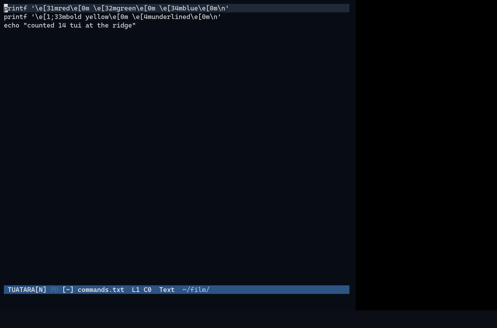

# kitty

Read the manual:
[tuatara-editor.github.io/tuatara-kitty](https://tuatara-editor.github.io/tuatara-kitty/).

Windows of the kitty terminal, opened, read and typed into from Tuatara.

A kitty window here is one of a kitty that Tuatara starts itself, never your own
kitty: drawn by the graphics card, with kitty's ligatures and pictures. Tuatara
talks to it over a socket of its own, and only there. Remote control is allowed
over that socket alone, given on kitty's command line, which no configuration
file can undo, so a program run in the window, or a file shown in it, cannot
steer it. One of the Tuatara project's packages, not part of the editor.

`M-x kitty` opens a window. The manual says how to read a window's text into a
buffer and type into one, how to run Tuatara itself in a kitty, how to set the
looks, and what keeps the windows safe.

<picture>
  <source media="(prefers-color-scheme: light)" srcset="media/kitty-light.gif">
  
</picture>

## What it needs

- Tuatara 0.90.25 or later.
- The kitty terminal, version 0.28 or later, which includes `kitten`.

| System | Command |
|---|---|
| Fedora | `sudo dnf install kitty` |
| Ubuntu, Debian | `sudo apt install kitty` |
| Arch, Omarchy | `sudo pacman -S kitty` |

## Installing it, step by step

1. **Install what it needs**, with the command for your system above.
2. **Open your init file**: in Tuatara press `C-x C-f`, type
   `~/.config/tuatara/init.lisp` and press `RET`.
3. **Add this line** to it:

   ```lisp
   (load-package "kitty" :source "https://github.com/Tuatara-Editor/tuatara-kitty")
   ```

4. **Save** with `C-x C-s`, **quit** with `C-x C-c`, and **start Tuatara
   again**. Answer `y` when it asks whether to load kitty; it asks once.
5. **Check it**: `M-x kitty` opens a kitty window.

## On a machine without internet

Tuatara compiles the package itself, so only fetching it needs the internet.
On a machine with internet:

```sh
git clone https://github.com/Tuatara-Editor/tuatara-kitty
git -C tuatara-kitty verify-tag "$(git -C tuatara-kitty describe --tags --abbrev=0)"
```

Copy the directory to the other machine, for instance to
`~/tuatara-packages/tuatara-kitty`, install kitty there from the system's own
packages, and name the directory in the init file:

```lisp
(load-package "kitty" :source "~/tuatara-packages/tuatara-kitty")
```

Carrying over the compiled files as well, so the other machine skips the
compiling, is in Tuatara's manual, chapter 19, "On a machine without
internet".

## Credits

kitty is by Kovid Goyal; this package drives it by its remote control.

## License

GPL-3.0-or-later; see `LICENSE` at the top of this repository.

## Working on it

```sh
tools/test.sh
```

runs its tests against a Tuatara source tree: `../tuatara` beside this
repository, or `../../tuatara` beside the directory it is in, unless
`TUATARA_SOURCE` names another. How a package is laid out and which of
Tuatara's names it may use are in Tuatara's
[HACKING.org](https://github.com/Tuatara-Editor/tuatara/blob/main/HACKING.org);
bug reports, ideas and how changes are made in
[CONTRIBUTING.md](CONTRIBUTING.md). The manual's source is in `doc/manual/`;
`tools/manual-html.sh` in a Tuatara tree, given this repository's directory,
makes its pages.
